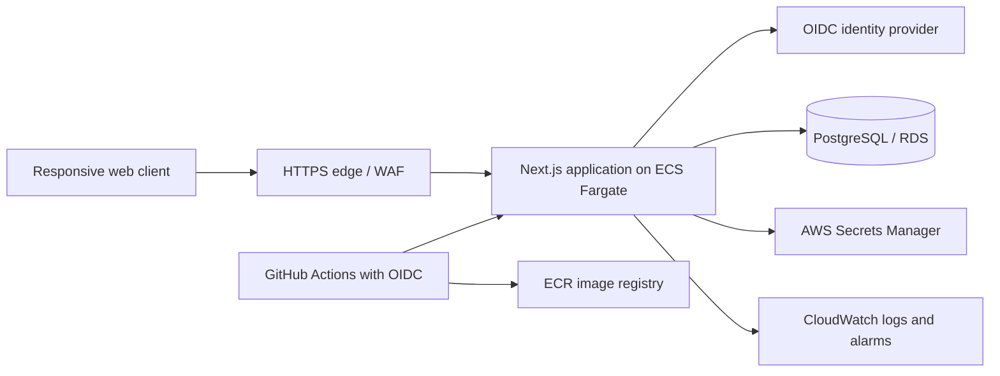

# System design

## Product scope

Launchpad helps one person turn a six-month career ambition into weekly learning, project, portfolio, interview, and networking actions. The first release prioritizes a clear dashboard and roadmap. Users should be able to create goals, record progress, attach proof of work, and review momentum after identity and persistence are fully connected.

## Architecture

The current repository implements the browser dashboard, Next route handlers, Prisma client and PostgreSQL schema, app health probe, local Docker Compose stack, CI/security workflows, and a partial ECS Terraform foundation. Identity provider, API ownership enforcement, cloud perimeter, RDS, ingress, telemetry export, and automated deployment are explicit integration tasks, not implemented capabilities.

## Core domain

- `User`: identity subject, email, display name, timestamps.
- `Goal`: user-owned objective, status, optional due date and description.
- Planned follow-up entities: `Milestone`, `CheckIn`, `Skill`, `Project`, `Artifact`, `Application`, and `Contact`. Keep evidence records linkable to an owner and project.

Every user-owned database lookup must include `userId` from a verified server-side session. Never accept the owner identifier from request JSON. Add unique constraints and indexes only with migration review and measured query patterns.

## Reliability and scale path

Begin with a stateless app service and managed PostgreSQL. Add a CDN for static assets, connection pooling, PITR backups, and tested restores. Use queue-backed workers only when scheduled reminders or integrations need asynchronous retries. Cache read-heavy, non-sensitive shared content first; do not cache private plans across users. Scale app tasks on CPU/request latency and database on measured connection/query pressure. Set explicit resource limits and graceful shutdown behavior before increasing replicas.

## Design decisions

- Next.js App Router keeps the initial product and server APIs in one deployable unit.
- PostgreSQL provides relational ownership constraints and durable history.
- Prisma gives typed access and reviewable migrations.
- ECS/Fargate provides a standard container deployment target without a long-lived host.
- CI uses short-lived GitHub Actions identity for cloud deployment once OIDC trust is configured; long-lived keys are not part of the design.
